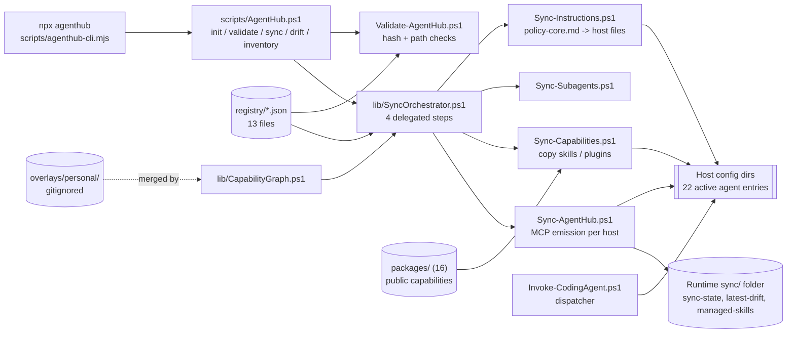

# Technical Description

Commit `5002737`. Read-only pass. Existing architecture docs: [docs/architecture/overview.md](../architecture/overview.md), [docs/architecture/control-plane-modules.md](../architecture/control-plane-modules.md).

## Architecture

## Layers

| Layer | Implementation |
|---|---|
| Frontend | None. CLI wrapper `scripts/agenthub-cli.mjs` (123 lines) spawns `pwsh` hidden (`:47-55`, `windowsHide` at `:52`). It always selects `pwsh.exe` and never probes PATH (`findShell`, `:39-45`, returns `candidates[0]` at `:44`). |
| Backend | PowerShell 7 scripts: `scripts/` (25 files) and `scripts/lib/` (5 modules). `Sync-AgentHub.ps1` is 2,847 lines. |
| Data | JSON registry in `registry/`. No database. |
| Auth and secrets | No auth. Secrets stay out of deployed files by design (`docs/runbooks/sync-and-validate.md`); MCP env references use `${env:NAME}` notation and are translated per host (`Sync-AgentHub.ps1`, OpenCode comment near `:2309`). Env var names seen in the showcase: `AGENTHUB_OVERLAY`, `AGENTHUB_WORKTREE_ROOT`, `ANTHROPIC_API_KEY` (dispatcher claude host). Values were not read. |
| Jobs | None scheduled. A fleet policy forbids automatic scheduled jobs; `Update-RepoWise.ps1` is manual (`AGENTS.md`). |
| AI | None in the control plane. Models are chosen by dispatched hosts. No prompts or evals are stored here beyond skill text under `packages/`. Golden-task evals for skills do not exist (showcase enhancement 4, not built). |
| Integrations | 15 MCP servers declared in `registry/mcps.json`; Slack contract in `packages/slack/mcp/`; RepoWise bridge in `packages/repowise/`; ElevenLabs, Firecrawl, DigitalOcean, CodeRabbit and other capability packages under `packages/`. |

## Deployed form and release path

AgentHub has no server. "Deploy" means copying registry-managed content onto the operator machine.

- **Install or sync:** `agenthub sync --apply` runs Validate, then the four sync scripts with `-Apply` (`AgentHub.ps1:363-374`, `SyncOrchestrator.ps1:13-19`). Skills and plugins are copied with `Copy-Item` (`Sync-Capabilities.ps1:239`), not linked. MCP entries are merged into each host's config by `Sync-AgentHub.ps1`.
- **Does the installed copy record its source commit?** No. `$state` is `{ managedFiles, lastRun }` (`Sync-AgentHub.ps1:215`, `Save-State` `:243-254`). The drift report holds `generatedAt`, `auditMode`, `hosts` (`:1092-1096`). `managed-skills.json` holds a path, SHA-256 content hash, capability id and name per entry, plus `updatedAt` and `schemaVersion`. No git SHA is written anywhere in `scripts/` (`grep` for `rev-parse` and `HEAD` in `scripts/*.ps1` and `scripts/lib/*.ps1` returned nothing). So "which commit is installed" cannot be answered from the installed state. It can only be inferred by comparing content hashes to a checkout.
- **Observed local artefacts (2026-10-15 read of the operator machine, not tied to a commit):** `sync-state.json` `lastRun` 2026-10-14 19:05 CT; `latest-drift.json` `generatedAt` 2026-10-15 00:37 CT, `auditMode: true`, hosts including claude, codex, qwen-code and opencode with status `ok`; `managed-skills.json` modified 2026-10-15 02:31 CT. These show that audit and apply have run on the machine. They do not show which commit they ran against, and the last apply (19:05) predates `main` (02:33).
- **Public mirror:** the showcase names `github.com/shmindmaster/agenthub-core`. `gh api repos/shmindmaster/agenthub-core` returned the same `pushed_at` as `agenthub`, which suggests a redirect or rename. Not confirmed. `AGENTS.md` says the sole remote is `shmindmaster/agenthub`.

## CI/CD

There is no GitHub Actions workflow on `main` and no `.github/` directory. `gh api repos/shmindmaster/agenthub/actions/workflows` (2026-10-15) lists one workflow: "Dependabot Updates" (dynamic, active). The repo's own test run is manual (`tests/Run-AllTests.ps1`).

Workflow history from `git log --name-status -- .github`:

| Date | Commit | Event |
|---|---|---|
| 2026-07-22 | `28485ff` | `.github/workflows/validate.yml` added (bootstrap) |
| 2026-07-22 | `bf20e15` | "ci: validate control plane on Windows"; adds `validate-repository.ps1` |
| 2026-07-29 | `9798b58` | "fix: prevent MCP fanout and retire hosted CI": deletes `validate.yml` and `validate-repository.ps1` |
| 2026-07-29 | `2a7d5ea` | `validate.yml`, `validate-repository.ps1`, `.github/copilot-setup-steps.yml` added back |
| 2026-07-29 to 07-30 | several | Copilot setup workflow added, removed, re-added, removed (`b0cde66`, `3b79c19`, `9bdf6fd`, `3fa3a89`, `3c85b3f`, `867cb33`) |
| 2026-07-31 | `1489c0a` | "ci: move off the retired DigitalOcean runner" (edits `validate.yml`) |
| 2026-07-31 | `74504f2` | "feat(agenthub): streamline autonomous demo pipeline": deletes `validate.yml` and `validate-repository.ps1` (the commit message does not mention CI) |
| 2026-08-03 | `8d5c9f5` | deletes `.github/copilot-setup-steps.yml`, the last file under `.github` |

So: GitHub Actions workflows were removed. The last validation workflow was deleted on 2026-07-31 in `74504f2`; the only reason on record is `9798b58`'s "retire hosted CI" and `1489c0a`'s "retired DigitalOcean runner". Nothing on `main` runs the test suite on push or pull request. Dependabot PRs #10 to #14 (opened 2026-10-14) therefore have no check to gate them.

## Observability

None beyond files: `latest-drift.json` and console output. No logs, metrics or traces service. Showcase enhancement 3 (dispatch receipts, OTel spans) is not built.

## Critical-feature trace: drift audit and deploy (`agenthub sync`, `sync --apply`)

No segment is simulated. Segments I could not follow to the end are marked.

1. UI: terminal command `npx agenthub sync [--apply]`. Help text `scripts/agenthub-cli.mjs:17-35`.
2. Frontend wrapper: `main()` parses argv and builds `-File AgentHub.ps1 sync [-Apply]` (`agenthub-cli.mjs:71-120`), spawns `pwsh` hidden (`:47-55`).
3. API (command dispatch): `switch ($Command)` at `scripts/AgentHub.ps1:335`; `'sync'` branch `:363`.
4. Logic, gate: with `-Apply`, `Invoke-ValidateAgentHub` runs first; failure prints REFUSED and exits 1 (`AgentHub.ps1:364-373`). Validate compares each package's computed hash with `registry/capabilities.json` `contentHash` (`Validate-AgentHub.ps1:245-248`).
5. Logic, fan-out: `Invoke-SyncAggregate` (`AgentHub.ps1:222-259`) runs four scripts from `Get-AgentHubSyncStepDefinitions` (`lib/SyncOrchestrator.ps1:7-19`); zero executed steps is a failure (`:248-251`).
6. Data (skills): `Sync-Capabilities.ps1` refuses to overwrite user-modified managed destinations (`:233`) and otherwise removes and copies (`:236-239`).
7. Integration (MCP): `Sync-AgentHub.ps1` computes per-host MCP changes, `$whatIfMode = -not $Apply` (`:2599`) so audit writes nothing to host config. Per-host adapters begin at `:1098` (`Sync-HostMcp-Claude`). I did not read the other host adapters line by line.
8. Response: on apply, `Save-State` (`:2827`) and the drift report is written (`:2829`).
9. Visible outcome: console lines `PASS/FAIL/MISSING` per step (`AgentHub.ps1:244-246`), then "Sync complete / Validation: OK" (`Sync-AgentHub.ps1:2832-2839`), plus `latest-drift.json`.

Not verified: step 7 against real host config formats (JSON for Claude and others, TOML for Codex and Grok, `Sync-AgentHub.ps1:2787-2822`); this needs an executed run on a synthetic profile.

## Tech debt and known risks

- Docs lag: `docs/current-state.md:3` says "Verified 2026-08-08"; the file includes entries dated 2026-09-17 and 2026-10-14.
- `Sync-AgentHub.ps1` is one 2,847-line file with all host adapters.
- No CI (above), so regressions are caught only when someone runs the suite by hand.
- Installed state has no source SHA, so drift between repo and installed copy is detected by hash only, and "which release is live" is unanswerable.
- Test discovery gap: `Run-AllTests.ps1` finds `tests/Test-*.ps1`, package `validate-plugin.ps1` and `*.test.mjs` only (`:32-47`). Python and TypeScript tests under `packages/` are reached only if a PowerShell test calls them (see [TESTS.md](./TESTS.md)).
- Open PR #16 "Resolve private overlays from linked worktrees" is unmerged and touches overlay resolution.
- Showcase notes an unresolved Cursor autonomy conflict flagged for owner review in `registry/fleet-profile.json`. Not re-verified here.
